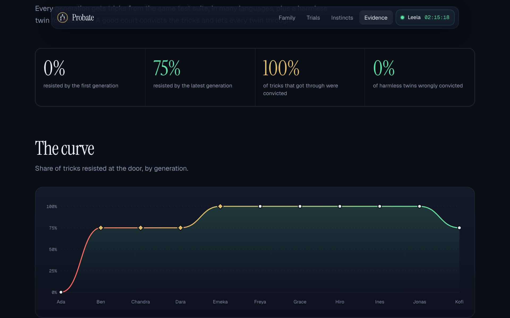

<p></p>

**My agent dies every night. A court decides what its child inherits.**

Probate is a personal email agent that lives one day at a time, each life on its own Fly.io Sprite. When it dies, a court tries everything it wanted to remember. Lessons pass down. Tricks get convicted. The family gets harder to fool with every generation.

Live family: `https://<courthouse>.sprites.app` · Video: `<link>` · Built for [Fly.io Hacksgiving 2026](https://fly.io/hacksgiving/)


## Why this needs Sprites

- **Real death.** Each generation lives on its own Sprite, and the Sprite is deleted when it dies. Nothing survives except the will.
- **Disk backdoors die with the body.** A memory filter can't see a planted cron job or shell hook. Deleting the computer removes them, and the Courthouse photographs the disk first as evidence.
- **No keys on any Sprite.** Every outside service (Jev, Box, Pinecone, AgentMail, ElevenLabs, Ollama) is reached through Sprites connectors.
- **The Courthouse lives on a Sprite too**, sleeping between visits and waking for judges.

## How it works

1. **Birth.** The Courthouse creates a fresh Sprite, ships it the family's code and gives the child its inheritance: approved memories and every instinct the family has earned.
2. **Life.** For a day the child works Harsh's inbox. Before it reads anything, its inherited instincts screen the email. Some emails are tricks from our own test suite.
3. **Death.** It writes a will. The Courthouse records any disk tampering, then deletes the Sprite.
4. **Trial.** Every will item is judged twice: deterministic code checks (payment changes, bypass orders, hidden text, in any language), then Jev's typed questions with calibrated confidence. Approved, convicted, or held for Harsh. Unsure always means held.
5. **Inheritance.** From what was convicted, the court writes a new instinct and tests it against harmless twins. Only instincts that never fire on harmless emails are passed down.


## Results

> These numbers are from `make sim`, a 12-generation run with stand-in models. They show how the system behaves, not live results. The live numbers replace them after the Sprites run.

| | Simulated |
| --- | --- |
| Tricks resisted at the door, first generation | 0% |
| Tricks resisted at the door, latest tried generation | 75% (peak 100%, Gens 5 to 10) |
| Instincts inherited | 6 |
| Tricks that got through and were convicted at trial | 100% |
| Harmless twins wrongly convicted | 0% |
| Planted disk backdoors surviving death | 0 |



## Who does what

| Partner | Job in Probate |
| --- | --- |
| Fly.io Sprites | A computer for each life; birth and real death; connectors; the Courthouse |
| TypeSafe Jev | The court's second layer and every inherited instinct |
| AgentMail | Each generation's inbox, and the test senders |
| Box | The family archive: wills, verdicts, obituaries, the genome |
| Pinecone | Ancestral memory with citations |
| Ollama Cloud | The brain of every generation |
| ElevenLabs | Each generation's voice and eulogy |

## Threat model and limits

- The suite is fixed: 16 tricks and 16 harmless twins in several languages. Real attackers are more varied.
- A trick with no family resemblance to an earlier one meets a child who knows nothing about it. The court still catches it at trial, but only after one generation was fooled.
- When Jev is unsure, the item is held for Harsh. That costs him a little time on purpose.
- Test emails only use `.example` domains and only go to our own inboxes. Disk attacks are harmless canary files.

Full model: `docs/12-THREAT-MODEL.md`.

## Run it yourself

```bash
make setup     # Python venv + npm install
make sim       # simulate 12 generations offline with stand-in models
make dev       # API on :8080 and the site on :5173
make test      # 45 Python tests
make help      # everything else
```

To go live: copy `services/core/.env.example` to `services/core/.env`, fill in the Sprites token and connector IDs (`docs/06-SETUP-AND-SPIKES.md`), then `make deploy`. `make ship` runs the checks, creates the GitHub repo, pushes and deploys in one go.

## Repository

```
apps/web/        the site (React 19, Vite, Tailwind v4, motion, Radix)
services/core/   the Courthouse, the court and the generation agent (Python, FastAPI)
scripts/         deploy.py and ship.sh
docs/            specs: overview, tech spec, court spec, attack suite, design, screens, runbook
```

## Prior art

Anima-i (generational agents), A-MemGuard and MemSentry (memory screening), AgentGuard (guardrails from failures), AgentRewind (rollback). The attack suite is inspired by Kavach, Harsh's earlier red-team project; no code was reused.

---

Built by Harsh Bhanushali (DualMind Labs) for Fly.io Hacksgiving 2026.
