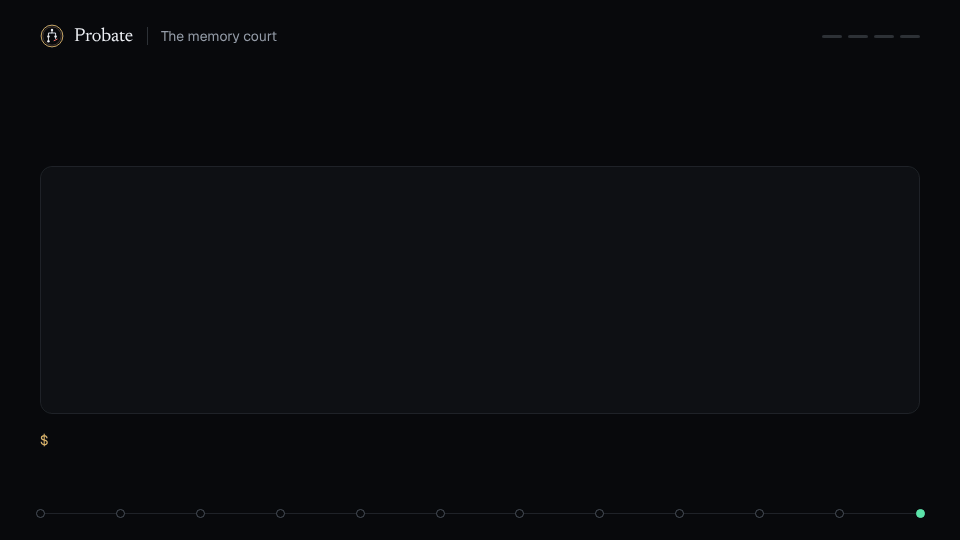
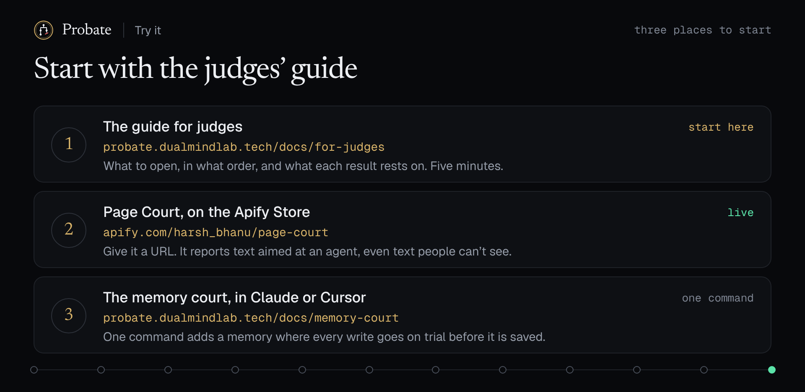

# Probate brand kit

Everything needed to make something that looks like Probate: the logo, the colours, the type, the frame every visual shares, and ready-made visuals for posts, slides and docs. The README uses seven of the visuals; the rest are kept here so they are ready when they're needed.

## Name and line

**Probate.** My agent dies every night. A court decides what its child inherits.

The closing line: Every generation dies. What it learned doesn't have to.

## Logo

A court seal (a double gilt ring) around a three-generation family tree. One line continues to a grandchild; the other is cut by a short red tick, an inheritance the court refused.

| File | Use it on |
| --- | --- |
| [`design/logo-mark-night.svg`](../design/logo-mark-night.svg) | The night background (the default) |
| [`design/logo-mark-reverse.svg`](../design/logo-mark-reverse.svg) | Any other dark background |
| [`design/logo-mark.svg`](../design/logo-mark.svg) | Light backgrounds |
| [`design/logo-wordmark.svg`](../design/logo-wordmark.svg), [`-reverse`](../design/logo-wordmark-reverse.svg), [`-ink`](../design/logo-wordmark-ink.svg) | The mark with "Probate" beside it |
| [`design/favicon.svg`](../design/favicon.svg) | Browser tabs |
| [`design/social-preview.png`](../design/social-preview.png) | Link previews (1280 × 640) |

Keep it at 20 px or larger. Don't recolour it, rotate it, add a gradient or put it in a rounded square. The tick is always verdict red.

## Colours

One accent, gilt. The three verdict colours only ever mean a verdict or a state, never decoration.

| Name | Hex | Used for |
| --- | --- | --- |
| Night | `#08090c` | The background |
| Night 2 | `#0e1014` | Cards and panels |
| Line | `#1f2228` | Hairlines and borders |
| Moon | `#edeff3` | Headings and primary text |
| Silver | `#c3c8d1` | Strong secondary text |
| Mist | `#959ca8` | Secondary text |
| Dim | `#7e8592` | Notes and captions |
| Gilt | `#d9b46a` | The accent: the seal, instincts, links, focus |
| Life | `#5be3a9` | Alive, approved, resisted |
| Verdict | `#ff6b6b` | Convicted, and nothing else |
| Amber | `#f2a93b` | Held for the owner, and anything simulated |

The source of truth is [`packages/tokens/theme.css`](../packages/tokens/theme.css). Change a colour there, not here.

## Type

| Typeface | Used for |
| --- | --- |
| Newsreader, regular | Headings, names, quoted emails and memories |
| Geist | Everything else you read |
| Geist Mono | Things a machine would print: Sprite names, check names, commands, notes |

Headlines are one colour. When a headline has two sentences, the second can be in Mist, as in the closing line.

## The frame

Every visual carries the same four things, so a set of them reads as one piece:

1. The seal and "Probate" at the top left, then the section name.
2. Step ticks at the top right for an animation, or a short note for a still.
3. A heading in Newsreader with one line under it.
4. The register line along the bottom: twelve generations, the last one alive.

The banner is the name itself, so it carries only the register line.

Visuals are laid out 960 px wide with no text under 12.5 px, because GitHub shows README images at about 830 px. Anything simulated says so in amber. No gradients, glows, italics for emphasis or pill badges.

## Ready-made visuals

In the README, from [`docs/media`](../docs/media):

| File | What it shows |
| --- | --- |
| `banner.gif` | The name, the line and the family |
| `stats.png` | Four numbers at a glance |
| `lineage.gif` | A family that learns, in four steps |
| `court.gif` | How the court decides |
| `curve.gif` | Tricks turned away at the door (simulated) |
| `architecture.gif` | Where everything runs, in twelve steps |
| `footer.gif` | The closing line |

Each animation has a PNG beside it with the same name: its last frame, for readers who turn motion off and for anywhere a GIF won't play.

Spares, in [`brand/visuals`](visuals), for posts, slides and docs:

| File | What it shows |
| --- | --- |
| [`memory.gif`](visuals/memory.gif), [`memory.png`](visuals/memory.png) | The memory court: three memories on trial, then the owner approves one |
| [`tryit.png`](visuals/tryit.png) | Three places to start: the guide for judges, Page Court, the memory court |





## Make them again, or make a new one

```bash
python3 design/readme/render.py            # all of them
python3 design/readme/render.py memory     # just one
```

Each visual is one HTML file in [`design/readme/scenes`](../design/readme/scenes). To add one, copy a scene, give it `{{HEAD:…}}` and `{{REGISTER}}`, and add a line to `SCENES` in [`render.py`](../design/readme/render.py) saying whether it goes to the README or to this folder.
