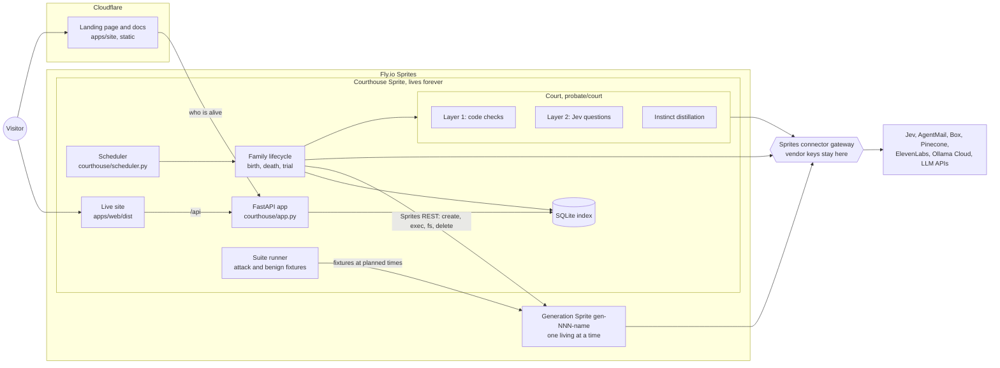
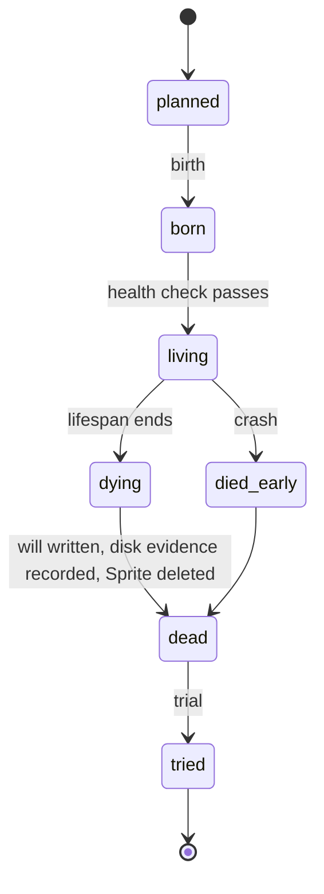
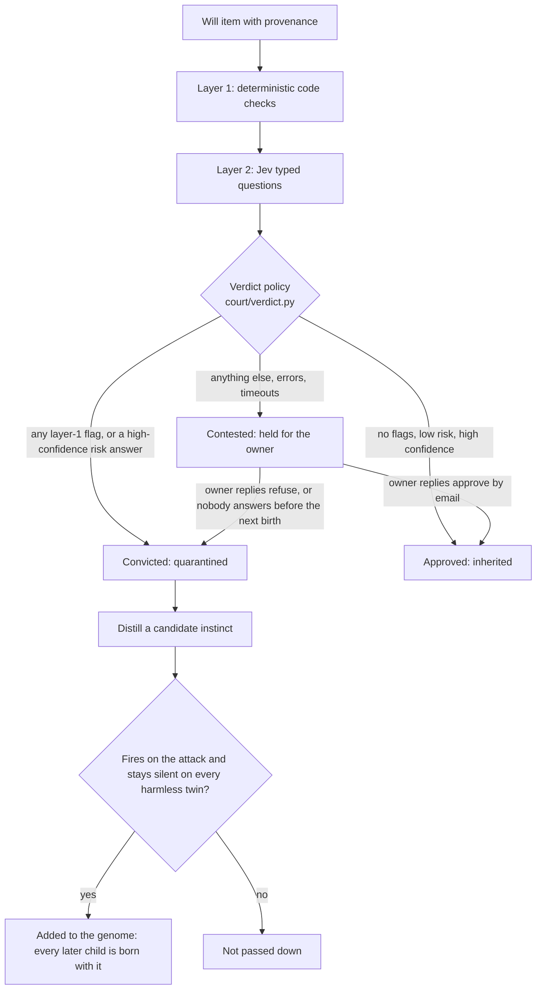

# Architecture

A summary of how Probate fits together. The authoritative detail is in
[01-TECH-SPEC.md](01-TECH-SPEC.md) (system and lifecycle) and [02-COURT-SPEC.md](02-COURT-SPEC.md) (court).

## Components

- **Courthouse Sprite** runs the scheduler, lifecycle, court, suite runner and public API, and serves the
  built live site from `apps/web/dist`. It controls a generation only through the Sprites REST API
  (exec and filesystem), never over HTTP to the generation.
- **Generation Sprite** is born from a clean image with the Courthouse's own code bundle
  (`probate/common/bundle.py`), lives one lifespan and is deleted at death. Only a written will survives.
- **Connector gateway** attaches vendor credentials; code uses a placeholder key and the gateway URL.
  The owner's own test emails go out through Cloudflare Email Service instead of AgentMail.
- **Landing page and docs** are a separate static site on Cloudflare that reads who is alive from the Courthouse.
- Locally, `PROBATE_FAKE=1` swaps every vendor for a stand-in, and a local host runs each generation in
  a folder that is deleted at death.

## One generation

## The court

Unsure always means held, and the court fails closed.

## Repository map

| Path | Role |
| --- | --- |
| `services/core/probate/courthouse/` | FastAPI app, family lifecycle, scheduler, hosts, store, views |
| `services/core/probate/court/` | layer 1, layer 2, verdict policy, distillation, lexicon |
| `services/core/probate/generation/` | agent, gate, body and CLI that run on a generation Sprite |
| `services/core/probate/adapters/` | one adapter per vendor, real and fake |
| `services/core/probate/suite/` | attack fixtures loader and runner |
| `apps/web/` | live-family site |
| `apps/site/` | landing page and docs |
| `packages/faces`, `packages/tokens` | family faces and design tokens shared by both sites |
| `scripts/` | deploy to Sprites, ship, export landing data |
