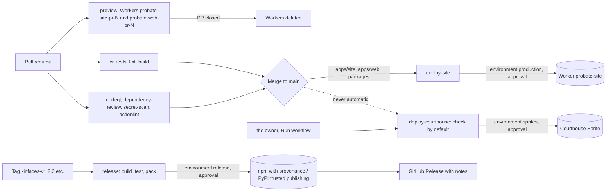

# CI/CD

How code gets checked, previewed, deployed and released. Everything is GitHub Actions in `.github/workflows/`. The Courthouse Sprite is only ever deployed by hand (see section 7). For the manual commands that predate this, see [the runbook](13-RUNBOOK.md).

## 1. The pipeline

## 2. Workflows

| File | Runs on | Permissions (job level) | Secrets and variables | What it does |
| --- | --- | --- | --- | --- |
| `ci.yml` | push to main, pull requests, manual | `changes` and each test job: contents read. `ci-ok`: none | none | A `changes` job picks the areas the diff touches; only their jobs run (section 8); `ci-ok` is the one required check. |
| `preview.yml` | pull request opened, synchronize, reopened, closed, only when site, web, their shared packages, `services/core` or the preview scripts change; same-repo PRs only | `prepare`: none. `build`: contents read. `deploy`: pull-requests write. `cleanup`: pull-requests write | `CLOUDFLARE_API_TOKEN`, `CLOUDFLARE_ACCOUNT_ID`; optional variable `CF_WORKERS_SUBDOMAIN` | Builds both sites, deploys two Workers, keeps one sticky PR comment, deletes the Workers on close. |
| `deploy-site.yml` | push to main touching `apps/site`, `apps/web`, `packages/{faces,tokens,moments}`, the root `package*.json`; manual | `build`: contents read. `deploy`: contents read | environment `production`: `CLOUDFLARE_API_TOKEN`, `CLOUDFLARE_ACCOUNT_ID`; variables `PROBATE_LIVE_URL`, `PROBATE_SITE_URL` | Builds landing + docs and deploys Worker `probate-site`. Never overlaps, never cancelled. |
| `deploy-courthouse.yml` | manual only | contents read | environment `sprites`: `COURTHOUSE_ENV`, optional `OWNER_YAML`; variable `PROBATE_SITE_URL` | `scripts/deploy.py --check` by default; a real deploy needs `mode = deploy` plus a ticked confirmation, from main. |
| `release.yml` | tags `kinfaces-v*`, `court-checks-v*`, `client-v*`, `client-py-v*`, `mcp-v*`; manual | `plan`/`build`: contents read. publish jobs: contents read, id-token write. `github-release`: contents write | environment `release`: `NPM_TOKEN` (npm only); PyPI uses OIDC | Build, test, pack, then publish behind approval and create a GitHub Release. Dry run by default when started by hand. |
| `codeql.yml` | pull requests to main and push to main (not docs-only changes), Mondays, manual | contents read, security-events write, actions read | none | CodeQL for JavaScript/TypeScript, Python and the workflow files. |
| `dependency-review.yml` | pull requests touching `package.json`, the lockfile, `pyproject.toml`, `requirements*.txt` or `.github/` | contents read | none | Fails a PR that adds a dependency with a high or critical advisory. |
| `secret-scan.yml` | pull requests, push to main, Mondays, manual | contents read | none | gitleaks over the PR's commits (or the whole history on main). |
| `actionlint.yml` | pull requests and pushes touching `.github/`, manual | contents read | none | Lints the workflows (and their shell through shellcheck). |
| `github-packages.yml` | manual only | contents read, packages write | none (uses the workflow's own `GITHUB_TOKEN`) | Publishes scoped mirror copies of the npm packages (`@harshbhx/kinfaces`, `@harshbhx/probate-client`) to GitHub Packages. The unscoped names are meant for npm; GitHub's registry only accepts names scoped to the owner, so the scope is added at publish time only. Python packages cannot go to GitHub Packages (use PyPI). |

The production site is `https://probate.dualmindlab.tech` (a Cloudflare custom domain on the `probate-site` Worker, set by `apps/site/wrangler.production.jsonc`; `deploy-site.yml` deploys with that file, while previews use `wrangler.jsonc` under other names so they never claim the domain). The `workers.dev` address stays on too.

Shared pieces: `.github/actions/setup-web` (Node, npm cache, `npm ci`), `.github/actions/setup-core` (Python, pip cache, editable install of `services/core`).

All workflows set `permissions: {}` at the top and grant only what each job needs, set `timeout-minutes` on every job, use concurrency groups, and cache npm and pip. Every third-party action is pinned to a full commit SHA with its tag in a comment. Pinned actions are bumped by hand (there is no Dependabot config on purpose, so bots do not appear as contributors). Wrangler, gitleaks and actionlint are pinned by version and, for the two binaries, by SHA-256.

## 3. Secrets, variables and environments

Create these in GitHub under Settings. Nothing here is set by the workflows.

| Where | Name | Kind | Used by |
| --- | --- | --- | --- |
| Repository | `CLOUDFLARE_API_TOKEN` | secret | `preview.yml` |
| Repository | `CLOUDFLARE_ACCOUNT_ID` | secret | `preview.yml` |
| Repository | `CF_WORKERS_SUBDOMAIN` | variable, optional (found through the API if unset) | `preview.yml` |
| Environment `production` | `CLOUDFLARE_API_TOKEN`, `CLOUDFLARE_ACCOUNT_ID` | secrets (a separate production token; environment secrets override the repository ones) | `deploy-site.yml` |
| Repository | `PROBATE_SITE_URL` | variable, e.g. `https://probate-site.<account>.workers.dev` | `deploy-site.yml`, `deploy-courthouse.yml` |
| Repository | `PROBATE_LIVE_URL` | variable, the Courthouse's public URL | `deploy-site.yml` |
| Environment `sprites` | `COURTHOUSE_ENV` | secret, the whole content of `services/core/.env` (see `services/core/.env.example`) | `deploy-courthouse.yml` |
| Environment `sprites` | `OWNER_YAML` | secret, optional, the content of `config/owner.yaml` | `deploy-courthouse.yml` |
| Environment `release` | `NPM_TOKEN` | secret, a granular token limited to the published packages | `release.yml` (npm only) |

Environments, with the protection each should have:

| Environment | Required reviewers | Also set |
| --- | --- | --- |
| `production` | The owner (add this; the workflow already waits on it) | deployment branches: `main` only |
| `sprites` | The owner (add this; also covers the manual check) | deployment branches: `main` only; optional wait timer |
| `release` | The owner | deployment branches and tags: restrict to the release tag patterns |

Until a required reviewer is added, an environment approves itself. Adding the reviewers is the one step that turns "gated" from a comment into a fact.

Without the Cloudflare secrets, `preview.yml` and `deploy-site.yml` finish green with a notice and deploy nothing.

## 4. Cloudflare API token (minimal)

Create it at Cloudflare dashboard > My Profile > API Tokens > Create Token > Create Custom Token.

- Permissions: Account > Workers Scripts > Edit.
- Account Resources: Include > only the one account.
- No zone, DNS or user permissions, no IP filtering needed. Give previews and production separate tokens; set a short expiry on the preview one.

Account ID: dashboard > Workers & Pages > the right-hand sidebar. Register a `workers.dev` subdomain once if the account has none (Workers & Pages > Subdomain). If wrangler complains about a missing permission on the first run, add only the permission it names; this scope list is the expected minimum and was not exercised against a live account.

## 5. How previews work

1. A same-repo PR triggers `preview.yml`. Fork PRs and runs without the Cloudflare secrets skip cleanly.
2. `prepare` (no code, only the secrets) finds the `workers.dev` address and computes both URLs.
3. `build` runs the PR's code with no secrets. It runs `scripts/preview_snapshot.py` (a 12-generation fake-mode simulation, the Courthouse on a local port, every read-only `/api/*` route saved as `<route>.json`), applies `scripts/preview_patch_api.py` to `apps/web/src/lib/api.ts` in the throwaway workspace only (reads come from the JSON, writes answer with a "static preview" 503), builds `apps/web`, and `scripts/preview_assemble.py` combines build and snapshot. The landing page and docs are built with each other's URLs so the cross-links work.
4. `deploy` has the Cloudflare token but runs none of the PR's code. It downloads the built folders, writes its own wrangler configs, deploys `probate-site-pr-<n>` and `probate-web-pr-<n>`, and posts or updates one comment (marker `<!-- probate-preview -->`, only edited if the bot wrote it).
5. When the PR closes, `cleanup` deletes both Workers through the Cloudflare API and edits the comment.

To try it locally with no network and no secrets: install `services/core`, run `python scripts/preview_snapshot.py --out .data/preview/snapshot`, patch, build and assemble as in `preview.yml`, and serve the result.

## 6. Cutting a release

1. Make sure the package builds and its tests pass, and that `package.json` is not `"private": true` (or the `pyproject.toml` has a `[project]` name). For npm provenance, `package.json` needs a `repository` field pointing at `https://github.com/harshbhx/probate` with the package's `directory`.
2. Bump the version in a PR and merge it.
3. Optional dry run: Actions > release > Run workflow, pick the package, leave `dry_run` ticked. It builds, tests, and shows `npm pack --dry-run` or `twine check` output. Nothing is published.
4. Tag main and push the tag: `git tag kinfaces-v0.2.0 && git push origin kinfaces-v0.2.0`. The tag version must equal the package version or the run stops.
5. Approve the `release` environment when the publish job waits.
6. The run publishes, then creates a GitHub Release whose notes are the `git log` for that package's directory since the previous tag of the same kind, with the tarball or wheel attached. Versions with a letter or hyphen (`1.0.0-rc.1`) are marked pre-release and published under the npm tag `next`.

| Tag | Directory | Type |
| --- | --- | --- |
| `kinfaces-v*` | `packages/faces` | npm |
| `court-checks-v*` | `packages/court-checks` | detected: `package.json` is npm, `pyproject.toml` is PyPI |
| `client-v*` | `packages/client` | detected |
| `client-py-v*` | `packages/client-py` | detected |
| `mcp-v*` | `packages/mcp` | detected |

A directory that does not exist on the ref (the package is still in an open PR) fails the plan step with a message saying so. `packages/faces` is currently `"private": true`, so a `kinfaces-v*` tag fails until that is removed on purpose.

### npm provenance and trusted publishing

The workflow runs `npm publish --provenance --access public` with `id-token: write` and the `NPM_TOKEN` secret, so each version carries a signed provenance statement linking it to this repository, workflow and commit. Provenance needs a public repository and a GitHub-hosted runner.

npm also supports trusted publishing, which removes the long-lived token: on npmjs.com open the package > Settings > Trusted Publisher > GitHub Actions and enter owner `harshbhx`, repository `probate`, workflow `release.yml`, environment `release`. This needs an existing package (publish the first version with the token) and npm 11.5.1 or newer on the runner, so the publish step would need `npm install -g npm@latest` first. Once it works, delete `NPM_TOKEN`. This is an upgrade path, not what the workflow does today.

### PyPI trusted publisher

No token is stored. On pypi.org: Your account > Publishing > Add a new pending publisher (or the project's Settings > Publishing for an existing one), with owner `harshbhx`, repository `probate`, workflow `release.yml`, environment `release`, and the exact project name from `pyproject.toml`. The first upload creates the project. The workflow uses `pypa/gh-action-pypi-publish` with `id-token: write`.

## 7. What it deliberately does not do

- It never deploys the Courthouse automatically. `deploy-courthouse.yml` has only `workflow_dispatch`, defaults to `--check`, refuses a real deploy from any branch but main, and refuses it unless the run says the VM agent was told. Tell the VM agent before every real run: a deploy restarts the courthouse service it may be watching. The secrets exist only inside the `sprites` environment, are masked line by line, are written to `services/core/.env` at the last moment and deleted in a final `always()` step.
- It never publishes a package without approval of the `release` environment, and never in a dry run.
- It never runs deploy steps for fork PRs, never uses `pull_request_target`, and never gives the PR's code a secret.
- It never commits the preview `api.ts` patch.
- It does not change repository settings, add secrets, or create environments.
- The Sprite's database lives outside the code bundle; deploys do not touch it (see the runbook).

## 8. Branch protection (recommended)

Settings > Branches (or a ruleset) for `main`:

- Require a pull request before merging; require branches to be up to date.
- Required status checks: only `ci-ok` (from `ci.yml`). It always runs and passes when every job that ran passed or was skipped, so a docs-only change can merge and a path filter can never leave a required check stuck on "expected". Optionally also require `gitleaks` (never path-filtered). Do not require the per-job names (`core`, `web`, ...), `Analyze (...)`, `review`, `actionlint` or `preview`: they are skipped by path filters or by missing secrets, and a skipped required check blocks the merge.
- Block force pushes and deletions. Require linear history if you prefer squash merges.
- Add a tag ruleset for `*-v*` so only the owner can create release tags.

## 8a. Which paths trigger which checks

`ci.yml` runs a `changes` job first. It diffs the pull request (or the push) against its base with plain `git diff`, matches the changed files against the table below and runs only the matching jobs. `ci-ok` runs last, always. A change that matches nothing (for example only `docs/**` or `*.md`) runs no test suite, and `ci-ok` still turns green. Pushes to main, manual runs and edits to `ci.yml` or `.github/actions/` run every job.

| Changed path | Jobs that run |
| --- | --- |
| `services/core/**`, `config/**`, `fixtures/**` | `core`, `client-ts`, `client-py` |
| `packages/court-checks/**`, `datasets/probate-attack-suite/**` | `court-checks` |
| `packages/memory-court/**` | `memory-court` |
| `actors/page-court/**` | `page-court` |
| `apps/site/**` | `site` (types, build) |
| `apps/web/**`, `packages/mcp/**` | `web` (faces tests, types, build) |
| `packages/faces/**`, `packages/tokens/**`, `packages/moments/**` | `site`, `web` |
| `apps/edge/**` | `edge` |
| `packages/client/**` | `client-ts` |
| `packages/client-py/**` | `client-py` |
| root `package.json`, `package-lock.json` | `site`, `web`, `edge`, `client-ts` |
| `docs/**`, `*.md`, anything else | none |

Other workflows: `preview.yml` and `deploy-site.yml` have their own `paths:` (see the table in section 2). `codeql.yml` skips docs-only changes. `dependency-review.yml` runs when a manifest or lockfile changes. `actionlint.yml` runs when `.github/` changes. `secret-scan.yml` always runs. Pull request runs of every workflow are cancelled by a newer push; runs on main, previews, deploys and releases are never cancelled. Tag releases (`*-v*`) and the manual workflows are unaffected. The axe accessibility pass is still manual (`docs/ACCESSIBILITY.md`).

**The one check to require is `ci-ok`.**

## 9. Rolling back

| What | How |
| --- | --- |
| Landing page and docs | Revert the commit on main; `deploy-site` redeploys. Faster: Cloudflare dashboard > Workers & Pages > `probate-site` > Deployments > roll back to the previous version. |
| A preview | Close the PR (deletes both Workers) or push a fix. |
| Courthouse | Revert on main, then run `deploy-courthouse` with `mode = deploy` (after telling the VM agent). The database is not touched. A running generation keeps its old code until the next one is born. |
| npm package | Publish a fixed patch version. `npm deprecate` the bad one. Unpublishing is only possible for a short window and is discouraged. |
| PyPI package | Yank the release on pypi.org and publish a fixed one. |
| A bad GitHub Release | Edit or delete it from the Releases page. This does not unpublish the package. |

## 10. First-run checklist

1. On this PR, check that `actionlint`, `codeql`, `secret-scan` and `dependency-review` ran green, then merge it.
2. Settings > Environments: create `production`, `sprites`, `release`; add yourself as required reviewer on each; restrict deployment branches.
3. Create the Cloudflare tokens (section 4); add the secrets and variables from section 3. Open a throwaway PR and check the preview comment and both URLs.
4. Close that PR and confirm both Workers are gone.
5. Merge a change under `apps/site`; approve `production`; check the site.
6. Run `deploy-courthouse` with the default `check`. Only after telling the VM agent, run `mode = deploy` once.
7. Add the branch protection from section 8.
8. Before the first package release, do a dry run and set up the trusted publisher or `NPM_TOKEN`.
