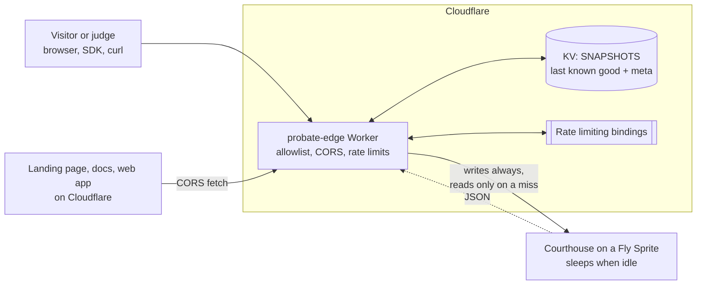
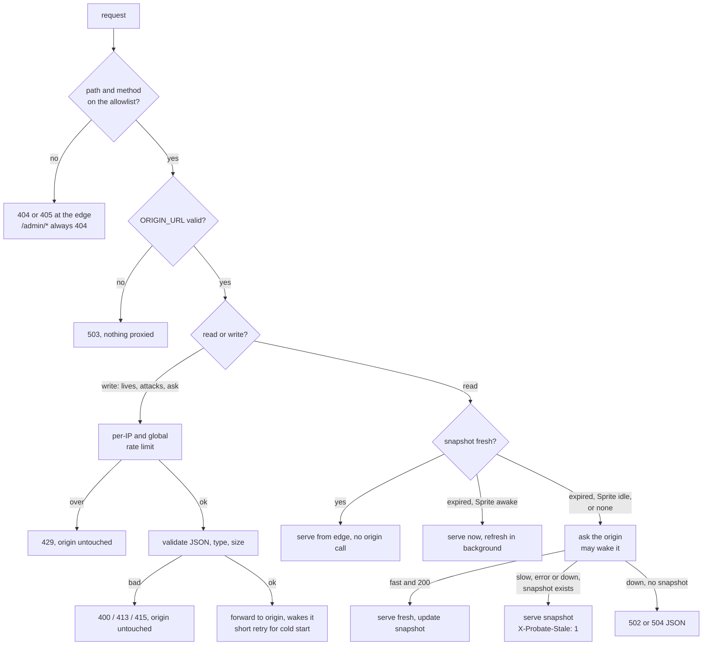

# The edge: a Cloudflare Worker in front of the Courthouse

`apps/edge` is a Cloudflare Worker named `probate-edge`. It is the public front door for the Courthouse API. Its job is simple: **a visitor who only looks never wakes the Fly Sprite; only a real action does.**

The Courthouse is a FastAPI app on a Sprite. A Sprite sleeps when idle and wakes on the next request. The Worker answers reads from a snapshot it already holds, and only passes a request to the Sprite when somebody starts a life, attacks the family or asks an ancestor a question.

## Architecture



The Worker never imports anything from the Courthouse and the Courthouse needs no change to sit behind it. The one open follow-up is the client IP the origin sees, see "Limits".

## Request flow



### Which calls wake the Sprite

| Route | Cached at the edge | Wakes the Sprite |
|---|---|---|
| `GET /edge/status` | no (computed from edge state) | **never** |
| `OPTIONS` anything | no (answered at the edge) | **never** |
| `/admin/*`, unknown paths, bad methods, rate-limited requests, invalid bodies | n/a (refused at the edge) | **never** |
| `GET /api/summary` | 15 s, SWR 30 s | only on a miss while the Sprite is idle (see below) |
| `GET /api/live` | 5 s, SWR 10 s | same; a keyed request only bypasses the cache when the Sprite is already awake |
| `GET /api/generations/{n}` | 15 s; **1 day** once `state` is `tried` or `died_early`; dropped after an ask | same |
| `GET /api/trials/{n}` | 1 h | same |
| `GET /api/trials/latest` | 15 s | same |
| `GET /api/genome`, `GET /api/evidence` | 60 s, SWR 120 s | same |
| `GET /api/events`, `GET /healthz` | 10 s and 30 s | same |
| `GET /api/judge/status` | never | yes, but a request with no key is answered 401 at the edge |
| `POST /api/lives` | never | **yes** (this is the action that starts a life) |
| `POST /api/attacks` | never | **yes** |
| `POST /api/generations/{n}/ask` | never | **yes** |

"Same" means: how often a read reaches the Sprite depends on whether the edge believes the Sprite is awake.

- **Awake** means a write reached the origin in the last `AWAKE_WINDOW_S` (20 min), or `/api/live` last reported a state other than `idle`, or `ORIGIN_MODE=always_on`. Awake reads use the short TTLs above, because the Sprite is awake and answering costs nothing.
- **Idle** is everything else. The TTL becomes at least `IDLE_TTL_S` (15 min). A snapshot younger than that is served without any origin call. At most one visitor per key per 15 minutes triggers a refresh, and if the Sprite is slow to wake (`SLOW_MS`, 2.5 s) that visitor also gets the snapshot (marked stale) and the wake finishes in the background.
- With **no snapshot at all** (first ever visit, or a KV wipe) a read has to go to the origin. That is the only unavoidable read-triggered wake. Prime it once after deploy: `curl https://<edge>/api/summary`.

Set `IDLE_TTL_S=0` to switch the idle behaviour off.

### Stale semantics

When the origin is slow (over `SLOW_MS` with a snapshot in hand), times out (`READ_TIMEOUT_MS`), errors (5xx, network, non-JSON) or the global origin read budget is spent, the edge serves the last known good snapshot. The JSON body is byte for byte what the origin once sent. Staleness is only in headers:

```
X-Probate-Stale: 1
X-Probate-Stale-Since: 2026-11-25T15:05:08.896Z     (when that snapshot was fetched)
X-Probate-Stale-Reason: slow | timeout | error | rate_limited
X-Edge-Cache: STALE
Age: 98
```

A snapshot older than `STALE_MAX_AGE_S` (7 days) is never served. With no snapshot the visitor gets a JSON error: `504 origin_timeout` or `502 origin_unavailable`, both with `Retry-After`.

Only real JSON 200 responses are stored. The Courthouse serves its SPA `index.html` for unknown paths; the edge treats that as a failure and never snapshots it. 404s are passed through and remembered for 10 s in memory only.

## What the Worker does and does not forward

- Requests to the origin are built from scratch. Only `Accept`, a fixed `User-Agent`, `X-Forwarded-For` (set to the visitor's `CF-Connecting-IP`, never what the visitor sent), `X-Forwarded-Proto`, a normalised `Content-Type` on writes, `X-Probate-Key` on judge routes, and the optional `Authorization: Bearer <ORIGIN_AUTH_TOKEN>` are sent. Cookies, `Authorization` from the visitor, `X-Probate-Admin`, hop-by-hop headers and anything else are dropped.
- `X-Probate-Key` is forwarded only on `POST /api/lives`, `POST /api/attacks`, `GET /api/live` and `GET /api/judge/status`, and only if it is 1 to 256 printable ASCII characters. It is never logged and never cached; a keyed `/api/live` response is not stored.
- Responses are rebuilt with an allowlist: the origin's `Set-Cookie`, `Server`, its own CORS headers and everything else are dropped. The edge adds `X-Content-Type-Options`, `Referrer-Policy`, a locked-down `Content-Security-Policy`, `Strict-Transport-Security` and `Cross-Origin-Resource-Policy`.
- The target is always `ORIGIN_URL` plus a path that matched the allowlist (`^/[A-Za-z0-9/_.-]*$`, no `..`, no `//`, no `%`). Redirects from the origin are not followed. It cannot be pointed at another host.
- No request bodies or keys are logged. The only log lines are `{"evt":"origin_fail","route":...,"reason":...}`.
- Writes: `POST /api/lives` (empty body or JSON, 4 KiB), `POST /api/attacks` (JSON object, 8 KiB), `POST /api/generations/{n}/ask` (`{"question": "<1 to 2000 chars>"}`, 4 KiB). Content type must be `application/json`. The cap is enforced on `Content-Length` and on the bytes actually read.
- Cold-start policy for writes: the whole write has `WRITE_TIMEOUT_MS` (20 s). A failed connection, or a 502/503/504 that is not a JSON answer from the app, is retried up to `WRITE_RETRIES` (2) times with 400 ms and 800 ms back-off. A timeout is never retried (the write may have landed) and returns `504` with `Retry-After: 5`.

## CORS

`ALLOWED_ORIGINS` is a comma separated list of exact origins (`https://probate.example.com`) and optional subdomain wildcards (`https://*.pages.dev`). The edge echoes the matching origin, sets `Vary: Origin`, never uses `*` and never allows credentials. Preflight (`OPTIONS`) is answered at the edge with `Allow-Headers: Content-Type, Accept, X-Probate-Key`, methods `GET, HEAD, POST, OPTIONS`, max age 600 s. Disallowed origins get a 403 on preflight and no CORS headers on real responses. Exposed headers: `X-Probate-Stale`, `X-Probate-Stale-Since`, `X-Edge-Cache`, `Retry-After`, `Age`. Non-browser clients without an `Origin` header are served normally: the API is public and read-only.

## Rate limits

Four buckets, all enforced before any origin call:

| Binding | Applies to | Default |
|---|---|---|
| `RL_READ_IP` | every read and `/edge/status`, per IP | 120 per 60 s |
| `RL_WRITE_IP` | writes and `/api/judge/status`, per IP | 6 per 60 s |
| `RL_WRITE_GLOBAL` | all writes together | 30 per 60 s |
| `RL_ORIGIN_READ_GLOBAL` | reads that would reach the origin (misses), all together | 60 per 60 s |

Over the limit: `429 rate_limited` with `Retry-After: 30`, and the origin never hears about it. For `RL_ORIGIN_READ_GLOBAL` a snapshot, if there is one, is served stale instead. If a binding is not configured the Worker falls back to an in-isolate fixed window with the same numbers.

## Configuration

Set secrets with `wrangler secret put`; everything else lives in `apps/edge/wrangler.jsonc`. Nothing secret is in the repo. For local `wrangler dev`, copy `.dev.vars.example` to `.dev.vars` (gitignored).

| Name | Kind | Default | Meaning |
|---|---|---|---|
| `ORIGIN_URL` | secret (required) | none | Courthouse Sprite base URL: `https://` (or `http://` for loopback), no path, no credentials. Unset or invalid: every route answers 503 (fails closed). Do not also list it under `vars`. |
| `ORIGIN_AUTH_TOKEN` | secret (optional) | none | Sent as `Authorization: Bearer ...` to the origin. Needed only if the Sprite URL is private (`url_settings.auth = "sprite"`). |
| `ALLOWED_ORIGINS` | var | placeholder | CORS allowlist, see above. Edit before deploying. |
| `ORIGIN_MODE` | var | `on_demand` | `on_demand` (Sprite sleeps) or `always_on` (clock free-runs, use only the short TTLs). |
| `READ_TIMEOUT_MS` | var | 10000 | Wait for a cold Sprite when there is no snapshot to show. |
| `SLOW_MS` | var | 2500 | With a snapshot, give up waiting and serve it (stale) after this long. |
| `WRITE_TIMEOUT_MS` | var | 20000 | Total budget for a write, including retries. |
| `WRITE_RETRIES` | var | 2 | Cold-start retries for writes (max 3). |
| `IDLE_TTL_S` | var | 900 | Minimum snapshot TTL while the Sprite is believed idle. 0 disables. |
| `AWAKE_WINDOW_S` | var | 1200 | How long after a write the Sprite counts as awake. |
| `STALE_MAX_AGE_S` | var | 604800 | Oldest snapshot ever served as stale. |
| `SNAPSHOTS` | KV binding | placeholder id | Last known good bodies (`snap:<path>`) and meta keys. Without it the Worker keeps snapshots in isolate memory only (no cross-location stale fallback). |
| `RL_*` | ratelimits | see above | Limits are set in `wrangler.jsonc`; `namespace_id` values must be unique in the account. |

## Deploy steps

Nothing here has been run against a real Cloudflare account. Harsh does these, in `apps/edge`:

```bash
cd apps/edge
npm install                                   # from the repo root is fine too
npx wrangler login                            # once, in a browser

# 1. KV namespace for snapshots. Copy the printed id into wrangler.jsonc (kv_namespaces[0].id).
npx wrangler kv namespace create SNAPSHOTS

# 2. Secrets. ORIGIN_URL is the Sprite URL (see "Get Sprite" -> url in docs/09-API-REFERENCE.md).
npx wrangler secret put ORIGIN_URL
npx wrangler secret put ORIGIN_AUTH_TOKEN     # only if the Sprite URL is private

# 3. Edit wrangler.jsonc: ALLOWED_ORIGINS (the real site origins), and optionally routes.

# 4. Check, then ship.
npm run lint && npm test
npx wrangler deploy --dry-run
npx wrangler deploy

# 5. Smoke test (replace the host), and prime the snapshots once.
curl -s https://probate-edge.<subdomain>.workers.dev/edge/status
curl -s -i https://probate-edge.<subdomain>.workers.dev/api/summary
curl -s -o /dev/null -w "%{http_code}\n" -X POST https://probate-edge.<subdomain>.workers.dev/admin/pause   # expect 404
```

Then point the sites at the edge URL instead of the Sprite URL, and add the sites' origins to `ALLOWED_ORIGINS`. To use your own hostname, set `workers_dev` to false and uncomment `routes` in `wrangler.jsonc`.

KV write budget: the Worker writes a snapshot when its body changed (at most once per 20 s per key) or every 10 minutes if unchanged, plus a few meta keys. On a quiet day this is far under the free plan's 1,000 writes a day; during a long active life it can approach it, and the Workers Paid plan removes the worry.

Rollback: `npx wrangler rollback`, or point the sites back at the Sprite URL (the Courthouse still serves everything itself).

## Verified locally, and honest limits

Verified: the 49 vitest cases in `apps/edge/test`, `tsc --noEmit`, `wrangler deploy --dry-run`, and a `wrangler dev` run in front of a locally running fake-mode Courthouse (proxy, cache hits, stale serving after killing the origin, `/admin` blocked, preflight, `/edge/status`).

Not verified (no real Cloudflare or Sprite was used):

- **Sprite wake time.** The docs claim 100 to 500 ms warm and 1 to 2 s cold; nobody has measured it. `SLOW_MS` and `READ_TIMEOUT_MS` are defaults chosen to be safe if it is slower. A cold start that exceeds `WRITE_TIMEOUT_MS` returns a 504 with `Retry-After`; the write may still have succeeded.
- **Idle detection is an inference.** "Idle" means "no write and no non-idle `/api/live` seen for 20 minutes". It cannot see a Sprite that was woken by something else (an operator, a cron, a direct hit on the Sprite URL). It errs toward serving older data, never toward waking the Sprite.
- **Stale data can be old.** In `on_demand` mode an idle snapshot may be up to 15 minutes old on purpose, and a stale fallback up to 7 days old. Snapshots are written to KV, which is eventually consistent (up to about 60 s between locations), so right after a write a visitor in another location can briefly see the older state. The Courthouse state changes only through writes in `on_demand` mode, so this is rarely visible.
- **Rate limits are approximations.** Workers rate limiting bindings are per Cloudflare location and eventually consistent, and the fallback is per isolate. They stop floods and sloppy scripts, not a determined distributed attacker. The global counters are best effort.
- **Client IP at the origin.** The edge sends `X-Forwarded-For: <visitor>`, but the Sprite's own proxy appends the Worker's address, and the Courthouse's `client_ip()` trusts the last entry. Behind the edge, the origin's per-IP limits and judge-key lockout therefore see one address for everybody. The edge's own per-IP limits are the real ones. A small Courthouse change (read the first `X-Forwarded-For` entry, but only when the request came with the edge's bearer token) would restore per-visitor limits there. This PR does not touch `services/core`.
- **A first visit after a KV wipe wakes the Sprite.** There is no data to show yet.
- `/edge/status` "reachable" is what the last real request saw, not a live probe, because a probe would wake the Sprite.
- The Courthouse's `/audio/*` is not proxied (the issue asked for `/api/*` and `/healthz`). If the eulogy audio should come through the edge, add a route and decide how to cache binary bodies.
