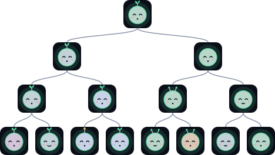
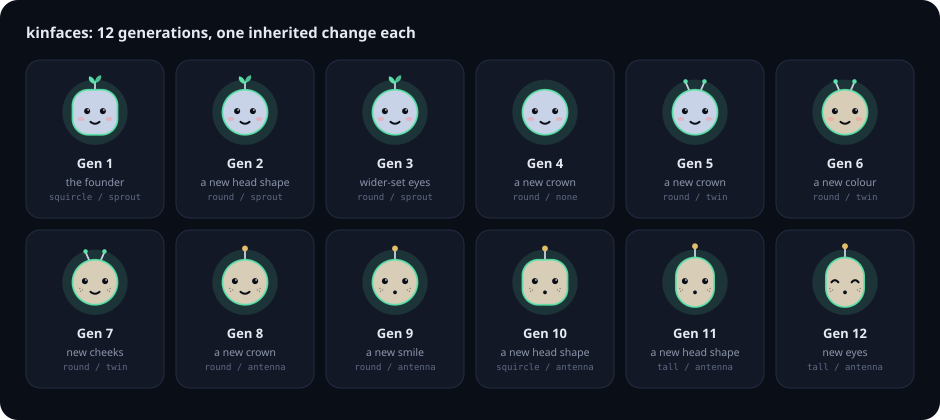

# kinfaces

Generated faces for a family line. Each child inherits its parent's face and changes **one trait**, so a whole family looks related, and the same seed gives the same faces on every machine.

[](https://www.npmjs.com/package/kinfaces) [](https://github.com/harshbhx/probate/blob/main/packages/faces/LICENSE) [](https://github.com/harshbhx/probate)



*Four generations, two children each. Every line is a parent and a child that differ in exactly one trait (head, eyes, mouth, crown, cheeks, skin tone, eye spacing). This image is made by the package: `familyTreeSvg("ada")`.*

- **Framework-free.** `faceSvg()` returns an SVG string. Works in Node, browsers, workers and edge functions.
- **React optional.** `kinfaces/react` is SSR-safe; React is an optional peer dependency.
- **Tiny.** About 9 kB gzipped for everything (unminified), one face is about 1.4 kB of SVG, no runtime dependencies.
- **Typed, ESM, tree-shakeable.** TypeScript types included, `sideEffects: false`.
- **Accessible.** Decorative by default; a `title` makes it a named image. Motion respects `prefers-reduced-motion`.

## 30-second quick start

```sh
npm install kinfaces
```

### Vanilla JS

```js
import { faceSvg } from "kinfaces";

document.querySelector("#avatar").innerHTML = faceSvg("ada", { gen: 3, size: 96, title: "Ada, generation 3" });
```

### React

```tsx
import { FamilyFace } from "kinfaces/react";
import "kinfaces/faces.css"; // optional: breathing and blinking

export const Avatar = () => <FamilyFace family="ada" gen={3} size={96} title="Ada, generation 3" />;
```

### Plain SVG string (Node, server, build script)

```js
import { writeFileSync } from "node:fs";
import { faceSvg, familyTreeSvg } from "kinfaces";

writeFileSync("ada-3.svg", faceSvg("ada", { gen: 3 }));
writeFileSync("ada-family.svg", familyTreeSvg("ada", { generations: 4, branches: 2 }));
```

Or serve it: `new Response(faceSvg(gen), { headers: { "content-type": "image/svg+xml" } })`.

### No JavaScript at the point of use

Generate files once, then use them anywhere as ``, or inline one with `faceDataUri(3)`:

```js
img.src = faceDataUri("ada", { gen: 3, background: "#0A0E17" });
```

Runnable versions are in [`examples/`](https://github.com/harshbhx/probate/tree/main/packages/faces/examples): `vanilla/` (a plain HTML page and a Node script) and `react/` (Vite + React).

## Inheritance, explained

A face is seven traits: `head` (4 shapes), `eyes` (4), `mouth` (4), `crown` (4), `cheeks` (3), `skin` (6 tones) and `wide` (eye spacing). That is 9,216 possible faces.



*Twelve generations of one line (`npm run gallery`).*

1. **Hash, not random.** All choices come from a small 32-bit hash of the seed. No `Math.random`, no clock.
2. **A founder.** With no name, generation 1 is a fixed face. With a family name, each trait is picked from the hash of the name, so `"ada"` and `"grace"` are different founders.
3. **One change per generation.** Generation `g` copies generation `g - 1` and changes exactly one trait. Which one is weighted (skin 3, head 2, crown 2, eyes 2, mouth 2, cheeks 1, wide 1), and the new value is always different from the parent's.
4. **Trees.** `familyTree(seed, generations, branches)` does the same for several children: each child copies its parent and changes one trait, chosen from the hash of its position (`"1.2.1"`), so siblings differ from each other too.
5. **Guarantee.** Two consecutive generations share exactly 6 of 7 traits (tested). The default family's generations 1 to 12 are pinned by a test, so upgrades will not change them.

```js
import { familyTree, flattenTree } from "kinfaces";

const tree = familyTree("ada", 3, 2); // 3 generations, 2 children each
for (const p of flattenTree(tree)) console.log(p.id, p.gen, p.changed); // "1.2.1" 3 "crown"
```

## API

All exports are from `kinfaces` unless noted.

| Export | What it does |
| --- | --- |
| `faceSvg(input, options?)` | A standalone `<svg>` string. |
| `faceDataUri(input, options?)` | The same as a `data:image/svg+xml` URI, for `` or CSS. |
| `faceGlyphSvg(input, options?)` | Just the inner `<g>` (64 x 64 units) to embed in your own SVG. |
| `familyTree(seed, generations, branches?)` | A branching family as plain data (`TreeNode`: `id`, `gen`, `traits`, `changed`, `children`). `branches` is a number or one number per generation. Default 2. Throws `RangeError` above 5,000 people. |
| `familyTreeSvg(treeOrSeed, options?)` | A whole family tree as one SVG string. Options: `faceSize`, `gap`, `lineColor`, `background`, `title`, `className`, `animate`, and `generations` / `branches` when you pass a seed. |
| `flattenTree(tree)` | Every person, parents first. |
| `faceAlt(input, { gen? })` | A sentence describing the face. |
| `traitsFor(gen, family?)` | The traits of a generation (frozen). |
| `inheritedChange(gen, family?)` | What a child got that its parent lacked (`"a new crown"`), `null` for gen 1. |
| `resemblance(a, b, family?)` | How many of 7 traits two generations share. |
| `mutation(gen, parent, family?)` | Which trait changes at `gen`, and to what. |
| `describeTraits(traits)`, `resolveFace(input, gen?)` | Helpers behind the above. |
| `FACE_CSS`, `kinfaces/faces.css` | The animation rules. |
| `FamilyFace`, `FaceGlyph` (`kinfaces/react`) | React components. Props: `gen`, `family`, `traits`, `life`, `mood`, `instincts`, `track`, `size`, `title`, `className`, `background`. |

`input` is a **generation number** (default family), a **family name**, or a **traits object**.

`faceSvg` options:

| Option | Default | Meaning |
| --- | --- | --- |
| `size` | `64` | Pixels, square. |
| `gen` | `1` | Generation, when `input` is a family name. |
| `title` | none | Accessible name. Without it the SVG is decorative. |
| `desc` | none | Longer description (adds `<desc>`). |
| `background` | none | CSS colour for a rounded tile behind the face. |
| `className` | none | Class on the `<svg>`. |
| `life` | `"alive"` | `"alive"`, `"sealed"` or `"unborn"`. |
| `mood` | `"idle"` | `"idle"`, `"happy"`, `"alert"`, `"fooled"`, `"sleepy"`. |
| `instincts` | `0` | Gold diamonds under the face (5 shown, then `+n`). |
| `look` | `{x:0,y:0}` | Eye offset. |
| `animate` | `false` | Adds breathing and blinking (embedded style). React's `FamilyFace` animates through `faces.css`. |

## Customisation

- **Light pages.** The skin tones are pale and were chosen for dark backgrounds. Pass `background: "#0A0E17"` (or any CSS colour) for a tile, or put the face on a dark element yourself.
- **Dark mode.** The faces are the same in both themes. Choose the tile per theme: `background: matchMedia("(prefers-color-scheme: dark)").matches ? "transparent" : "#0A0E17"`, or in React switch the prop. SVG strings can also take a class (`className`) so you can set CSS such as `.avatar { filter: drop-shadow(...) }`.
- **Your own traits.** Pass a traits object (`{ head, eyes, mouth, crown, cheeks, skin, wide }`) as `input` to draw exactly that face.
- **Colours and shapes are not options.** Ink, halo and gilt colours are constants. If you need a different palette, post-process the string (the colours are plain hex values).
- **PNG.** SVG is the output. To get PNG, rasterise it: `@resvg/resvg-js` in Node, `sharp`, or a `<canvas>` in the browser. See `examples/vanilla/make-avatars.mjs`.

## Accessibility

- **No `title` means decorative** (`aria-hidden="true"`). Use that when the name is already next to the face in text. `familyTreeSvg` follows the same rule.
- **With a `title` it is an image** (`role="img"`, `aria-label`, `<title>`). Name the person (`"Ada, generation 3"`), not "face".
- **`faceAlt(3)`** describes what the face looks like, for places that need it. It is not an accessible name.
- **Meaning is not carried by colour alone.** `life` and `mood` also change shapes (closed eyes, `!`, `?`).
- **Motion** is off under `prefers-reduced-motion: reduce`, including pointer-tracking eyes.
- **Contrast.** Faces sit on a dark tile by design. On white, use `background`.

## Bundle size and SSR

- Everything except React is about 9 kB gzipped (about 24 kB raw, unminified). Import only what you use and bundlers drop the rest.
- A face string is about 1.4 kB; with `animate: true` about 2.3 kB (the embedded stylesheet). In React use `faces.css` once instead.
- Pure functions, no DOM and no globals: safe in server components, SSR, workers and build scripts. `kinfaces/react` has `"use client"` only for the pointer-tracking hook.

## FAQ

**Is it unique per user?** No. There are 9,216 faces; collisions between unrelated names are expected. Use it for avatars, not identity.

**Same name, same face forever?** Yes within a major version for the default family's first 12 generations (pinned by a test). Trait derivation is the contract; exact drawing may be refined in minor versions.

**Can a family have siblings or merges?** `familyTree` gives siblings and branches (not merges). `faceSvg(name, { gen })` is the single-line form.

**Can I store the traits?** Yes, the traits object is plain JSON. Pass it back as `input`.

**Does it work in an `` tag?** Yes. Static faces work everywhere; `animate: true` uses an embedded `<style>` that some sanitisers strip.

**Node and browser support?** Node 18+, current browsers, React 18+ for the React entry.

**Is the hash secure?** No. FNV-1a (plus a finaliser for names) is for avatars only.

## Migrating the Probate app to the package

The Probate apps (`apps/web`, `apps/site`) currently depend on this folder through the npm workspace (`"kinfaces": "*"`) and build it before `dev` and `build`. Imports are already the public ones, so the switch is mechanical and can be done later by whoever owns those apps:

1. In each app's `package.json`, change `"kinfaces": "*"` to `"kinfaces": "^0.2.0"` (once 0.2.0 is published).
2. Remove the `prelint`, `predev` and `prebuild` scripts that run `npm run build -w kinfaces`.
3. Imports stay `kinfaces`, `kinfaces/react` and `kinfaces/faces.css`. 0.2.0 only adds exports, so nothing else changes.
4. To draw a family tree (for example the three branches of the real run), use `familyTree` and `familyTreeSvg` instead of hand-laying faces.

## Part of Probate

This is one piece of [Probate](https://github.com/harshbhx/probate), an email agent that lives one generation at a time and passes down only what a court approves. Built for Fly.io Hacksgiving 2026.

- Repository: [github.com/harshbhx/probate](https://github.com/harshbhx/probate)
- Live site: [probate.dualmindlab.tech](https://probate.dualmindlab.tech)
- Related: [probate-client](https://www.npmjs.com/package/probate-client), [probate-mcp](https://www.npmjs.com/package/probate-mcp)
- Mirrored on GitHub Packages as `@harshbhx/kinfaces`.

## Development

```sh
npm install                     # in the monorepo root
npm test -w kinfaces            # builds, then runs source and built-package tests
npm run build -w kinfaces       # dist/ (JS + .d.ts + faces.css)
npm run gallery -w kinfaces     # regenerate gallery.svg and family-tree.svg
```

## License

MIT. Copyright (c) 2026 Harsh Bhanushali.
